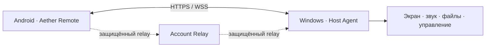
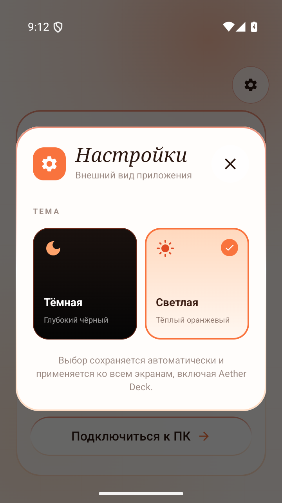
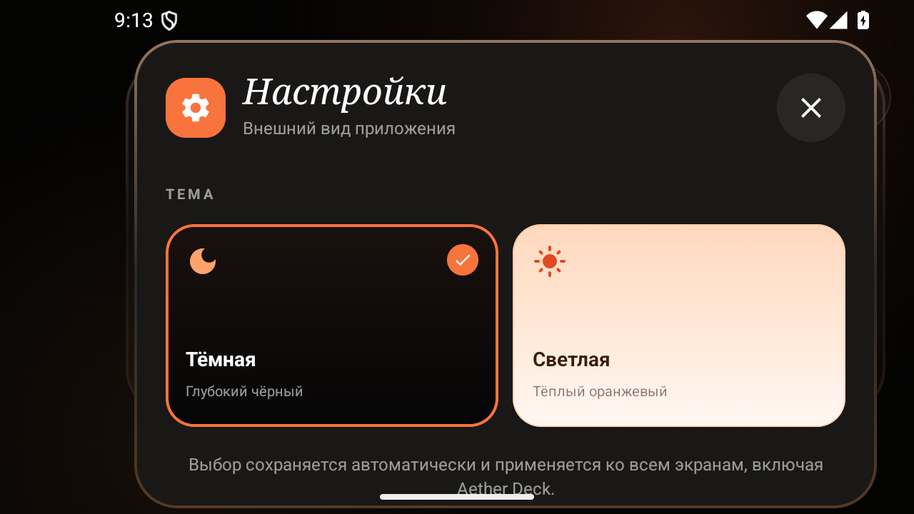

<p align="center">
  
</p>

<p align="center">
  
  
  
  
</p>

<p align="center">
  <strong>Безопасное управление Windows-компьютером с Android.</strong><br>
  Один проект для подключения, стриминга, обмена файлами и персональной панели Aether Deck.
</p>

<p align="center">
  <a href="https://t.me/+DqicSUkTJEAwNzI6"><strong>Telegram проекта</strong></a>
  &nbsp;•&nbsp;
  <a href="https://kapitoshkadev1.netlify.app/#"><strong>Сайт разработчика</strong></a>
</p>

---

## Возможности

- Защищённое сопряжение телефона и компьютера по QR-коду или коду подключения.
- Управление мышью, клавиатурой, мультимедиа и системной громкостью Windows.
- Передача файлов и буфера обмена между устройствами.
- Трансляция экрана и фонового звука.
- Aether Deck: кнопки, переключатели, слайдеры, папки, макросы и пользовательские иконки.
- Подключение по локальной сети, VPN или через account relay.
- Wake-on-LAN и удалённое пробуждение зарегистрированных устройств.

## Состав репозитория

| Каталог | Назначение | Технологии |
| --- | --- | --- |
| [`mobile/`](mobile/) | Нативное Android-приложение | Kotlin, Jetpack Compose, Material 3, OkHttp |
| [`host/`](host/) | Агент для Windows | Electron, React, TypeScript, Node.js |



## Интерфейс

<p align="center">
  
  &nbsp;&nbsp;
  
</p>

## Быстрый старт

### Android

Требуются JDK 17+ и Android SDK 36. Из каталога `mobile/`:

```powershell
.\gradlew.bat :app:assembleDebug
.\gradlew.bat :app:installDebug
```

### Windows-host

Требуются Windows 10+ и Node.js 20+. Из каталога `host/`:

```powershell
npm install
npm run build
npm start
```

После запуска host покажет данные сопряжения. Откройте мобильное приложение, выберите подключение к ПК и отсканируйте QR-код.

## Проверка проекта

```powershell
# mobile/
.\gradlew.bat :app:testDebugUnitTest :app:lintDebug :app:assembleDebug
npm install
npm run lint
npm test
npm run build

# host/
npm install
npm test
npm run lint
npm run build
```

## Безопасность

Aether Remote использует HTTPS/WSS, проверку TLS-отпечатка хоста, ограниченный IPC и валидацию входящих протокольных сообщений. Секреты, keystore-файлы, локальные `.env`, сертификаты и готовые установщики исключены из репозитория.

Уязвимости следует сообщать приватно через GitHub Security Advisories. Подробности находятся в [`SECURITY.md`](SECURITY.md).

## Версия

Текущая версия: **2.5.0**. Android: `versionCode 27`, `versionName 2.5.0`. ПК-клиент выпускается на Electron; экспериментальный Rust/Tauri-прототип намеренно не входит в релизный репозиторий.

---

<p align="center">
  Создано <a href="https://kapitoshkadev1.netlify.app/#"><strong>KapitoshkaDev</strong></a><br>
  Новости и обновления — в <a href="https://t.me/+DqicSUkTJEAwNzI6"><strong>Telegram-канале Aether Remote</strong></a>
</p>
