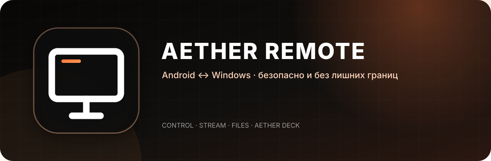
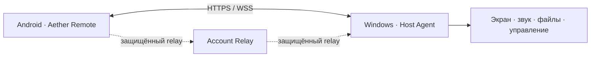

  

  
  

  <strong>Безопасное управление Windows-компьютером с Android.</strong> 
  Один проект для подключения, стриминга, обмена файлами и персональной панели Aether Deck.

  <a href="https://github.com/Kapitoshka11/aether-remote/releases/tag/v2.5.1"><strong>Скачать 2.5.1</strong></a>
  &nbsp;•&nbsp;
  <a href="https://t.me/+DqicSUkTJEAwNzI6"><strong>Telegram проекта</strong></a>
  &nbsp;•&nbsp;
  <a href="https://kapitoshkadev1.netlify.app/#"><strong>Сайт разработчика</strong></a>

---

## Возможности

- Защищённое сопряжение телефона и компьютера по QR-коду или коду подключения.
- Управление мышью, клавиатурой, мультимедиа и системной громкостью Windows.
- Передача файлов и буфера обмена между устройствами.
- Трансляция экрана и фонового звука.
- Aether Deck: кнопки, переключатели, слайдеры, папки, макросы и пользовательские иконки.
- Подключение по локальной сети, VPN или через account relay.
- Wake-on-LAN и удалённое пробуждение зарегистрированных устройств.

## Состав репозитория

| Каталог | Назначение | Технологии |
| --- | --- | --- |
| [`mobile/`](mobile/) | Нативное Android-приложение | Kotlin, Jetpack Compose, Material 3, OkHttp |
| [`host/`](host/) | Агент для Windows | Electron, React, TypeScript, Node.js |

## Безопасность

Aether Remote использует HTTPS/WSS, проверку TLS-отпечатка хоста, ограниченный IPC и валидацию входящих протокольных сообщений. Секреты, keystore-файлы, локальные `.env`, сертификаты и готовые установщики исключены из репозитория.

Уязвимости следует сообщать приватно через GitHub Security Advisories. Подробности находятся в [`SECURITY.md`](SECURITY.md).

## Версия

Текущая версия: **2.5.1**. Android: `versionCode 28`, `versionName 2.5.1`. ПК-клиент выпускается на Electron; экспериментальный Rust/Tauri-прототип намеренно не входит в релизный репозиторий.

---

  Создано <a href="https://kapitoshkadev1.netlify.app/#"><strong>KapitoshkaDev</strong></a> 
  Новости и обновления — в <a href="https://t.me/+DqicSUkTJEAwNzI6"><strong>Telegram-канале Aether Remote</strong></a>

